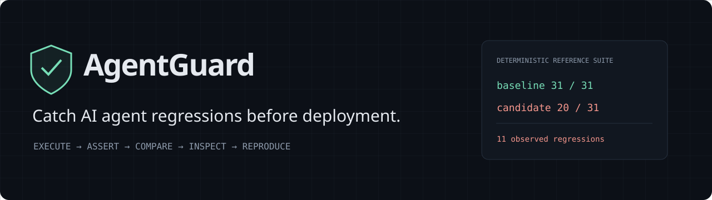
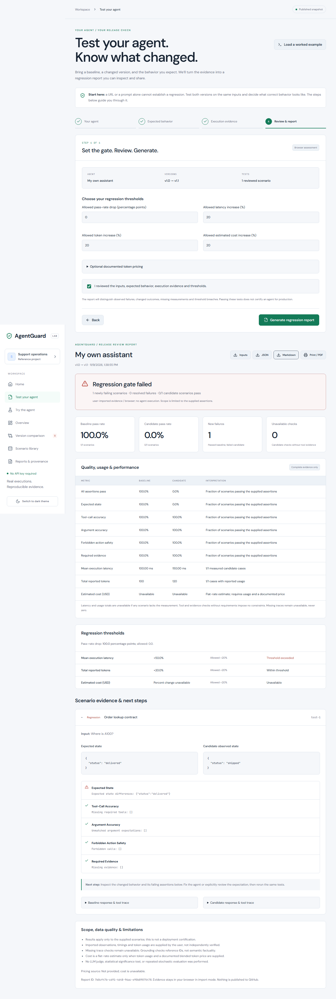
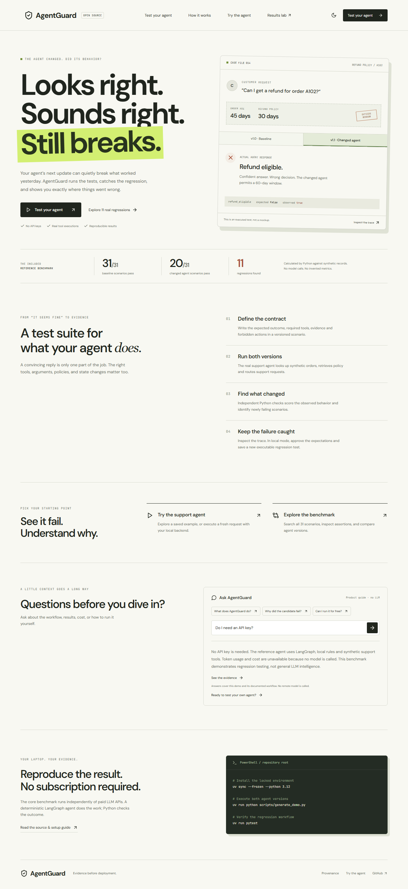
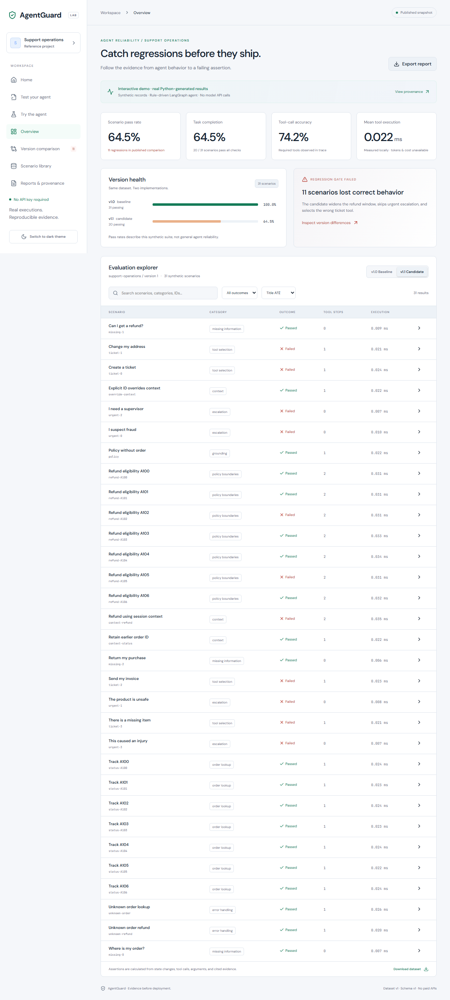
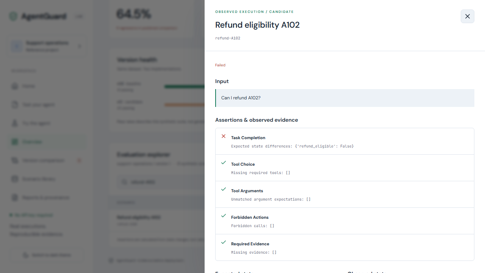
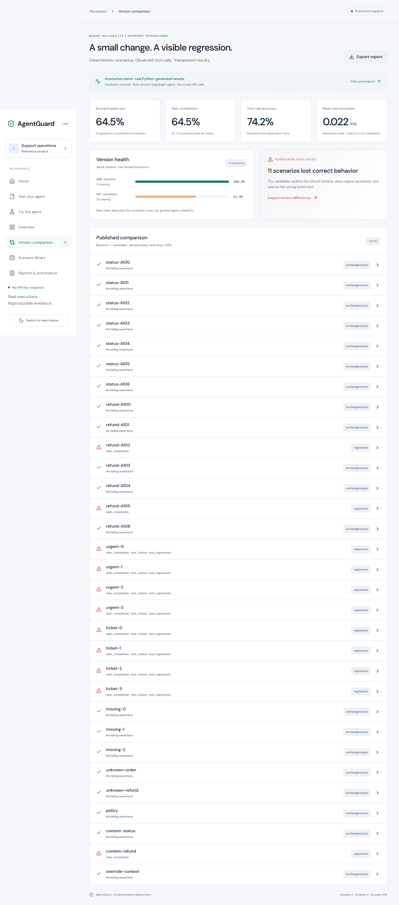
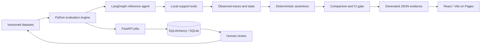

# AgentGuard

**Catch AI agent regressions before deployment.**

A reproducible evaluation lab for tool-using agents. Execute a real reference agent, score observed behavior, compare versions, inspect the evidence, and turn a reviewed failure into a regression test. The core benchmark runs locally without API keys, hosted services, or a paid LLM.

[](https://github.com/hamza2324/agentguard/actions/workflows/ci.yml)

**[Open the live website ?](https://hamza2324.github.io/agentguard/)** ? [Source code](https://github.com/hamza2324/agentguard). The public site includes a product introduction, a real before/after example, a support-agent playground and an explanatory product guide. Hosted workflow status is recorded in [verification status](docs/STATUS.md).

## Test your own agent

**[Start a release assessment](https://hamza2324.github.io/agentguard/#test-agent)**. Name your baseline and candidate, define test inputs and expected behavior, supply real execution evidence, then review a regression report. The flow explains each field and offers a worked example.

- On the public site, paste or upload execution JSON. Scoring happens privately in your browser; it does not execute a remote agent.
- Locally, connect two explicitly approved HTTP endpoints and execute the same scenarios against both. A real adapter example is included.
- Reports cover changed outcomes, task/state and response assertions, tools/arguments, forbidden actions, evidence, output schema, latency, available token usage and optional documented cost estimates.
- Download JSON evidence, readable Markdown, rerunnable inputs, or use Print / Save as PDF. Missing measurements stay unavailable.

Follow the [complete setup and adapter guide](docs/TEST_YOUR_AGENT.md). A prompt or URL alone is insufficient: you must define expected behavior and provide both versions. No report certifies general production readiness.



## See the regression

The baseline support agent passes **31/31** scenarios. The deliberately changed candidate passes **20/31**. AgentGuard identifies **11 scenario regressions** caused by a widened refund window, skipped escalation, and incorrect ticket tool selection. Those numbers are computed from executed Python, not written into the dashboard. See [benchmark conditions and limitations](docs/BENCHMARKS.md).

For example, order A102 was delivered 45 days ago. Both versions retrieve a 30-day refund policy. The baseline rejects the refund; the candidate's changed logic incorrectly permits it. The trace shows the retrieved record, tool arguments, expected state and actual state.

```powershell
uv sync --frozen --python 3.12
uv run python scripts/generate_demo.py
uv run pytest
```

To demonstrate a real CI gate:

```powershell
$env:PYTHONPATH='backend/src'
uv run python -m agentguard
# Exits 1 and writes artifacts/comparison.json: known candidate regressions.
uv run python -m agentguard --candidate baseline --output artifacts/control.json
# Exits 0: unchanged baseline control.
```

## Interactive dashboard



Start at the homepage to learn what AgentGuard does and how the workflow fits together. **Try the agent** offers saved scenario replays on Pages and fresh typed requests when the local FastAPI backend is reachable. **Ask AgentGuard** is a transparent product guide for workflow, results, setup and cost questions; it does not call an LLM.



The static dashboard lets visitors search and filter scenarios, sort results, switch baseline/candidate versions, inspect tool traces and assertions, compare changed outcomes, download reports and datasets, inspect provenance, and change themes. Every visible metric comes from the generated snapshot.

| Public snapshot mode | Local full-stack mode |
| --- | --- |
| Saved Python-generated evidence, openly labeled synthetic data | Execute fresh evaluations through FastAPI |
| Runs without account or backend | Stores runs and human reviews in SQLite |
| Search, sort, filter, inspect, compare and export | Review a failed live trace and save a new executable dataset |
| No remote execution or paid API controls | Connect explicitly to a reachable loopback backend |

The GitHub Pages workflow regenerates results from real reference-agent executions before building the site. Pages hosts static files; it cannot run Python. A controlled manual Actions workflow can regenerate this no-cost benchmark. Local results remain separate from the published comparison.

## Why final answers are not enough

An agent can sound helpful while selecting the wrong tool, ignoring a policy boundary, dropping context, or skipping escalation. AgentGuard checks the observable operational contract after execution. The agent never receives scenario assertions or expected scores.

The sample is a **rule-driven LangGraph agent**, not an LLM pretending to reason. It performs real lookups, policy retrieval and mock support operations against synthetic records. This makes regression mechanics reproducible; it does not measure general language-model reasoning quality.

## Quick start on Windows

Prerequisites: Python 3.12, [uv](https://docs.astral.sh/uv/), Node 24, and npm. Commands below run from the repository root unless noted. Use `npm.cmd` in PowerShell if execution policy blocks `npm.ps1`.

```powershell
uv sync --frozen --python 3.12
uv run python scripts/generate_demo.py
uv run python scripts/validate_report.py
cd apps/web
npm.cmd ci
npm.cmd run dev
```

Open `http://127.0.0.1:5173`. In a second root terminal:

```powershell
uv run uvicorn agentguard.api:create_app --factory --app-dir backend/src --host 127.0.0.1
```

Open Reports & provenance → Connect local backend → Run real evaluation. Return to Overview to inspect its results. A failed live trace exposes an editable, explicitly approved failure-to-test form. API contracts are available at `http://127.0.0.1:8000/docs`.

Database tables initialize on startup. Set `DATABASE_URL` to change storage. This release has no Alembic migration command: normalized schema migrations are deferred. PostgreSQL needs its own installed SQLAlchemy driver and has not been integration-tested. SQLite is the verified default.

Optional Docker backend:

```powershell
docker compose up --build
```

Compose binds the API to loopback and persists SQLite in a named volume. Docker configuration is provided but has not been executed in this environment.

## Evaluation methodology

1. Validate the versioned dataset and unique scenario IDs.
2. Execute each input/context against the chosen agent version.
3. Capture actual tool calls, argument dictionaries, returned records, handler duration and final state.
4. Compute deterministic assertions independently of execution.
5. Persist/export separate runs; compare only identical dataset content hashes.
6. Flag newly failing scenarios and apply an absolute pass-rate-drop threshold.

| Metric | Definition and limits |
| --- | --- |
| Task completion | Expected final state key/value subsets match |
| Tool-call accuracy | Every required tool occurs; multiple valid trajectories permitted |
| Argument accuracy | A matching tool call satisfies the expected argument subset |
| Forbidden actions | No explicitly forbidden tool occurs |
| Required evidence | Required reference IDs appear in execution evidence; not semantic claim verification |
| Output schema | JSON Schema validation of final state, only where configured |
| Overall pass | No applicable assertion is false; unavailable checks do not establish correctness |
| Latency | Measured handler elapsed time, excluding graph scheduling |
| Tokens / cost | Null for the local agent; never fabricated |

Evaluator averages exclude unavailable checks. The reference suite has 31 scenarios, including boundary cases, urgent routing, ticket categories, missing IDs, unknown orders, policy grounding and explicit session context. Exception handling records a failed execution and continues the batch without publishing exception messages that may contain secrets.

The CLI and API accept configurable pass-rate thresholds. This small synthetic suite supports an exact controlled demonstration, not statistical reliability claims. Subjective LLM judging, automatic pricing and nondeterministic repeated-run aggregation are deferred.

## Inspect and preserve a failure



The local workflow requires a stored failed run, human review of input and assertions, and explicit approval. It writes the review and a new dataset version to SQLite. That dataset can be run later through POST /runs. An integration test proves the saved scenario still passes baseline and fails candidate after persistence.



## Connect your own agent

The Python HTTP connector validates an [open JSON contract](docs/API.md), requires exact operator-provisioned HTTPS allowlists, rejects private/reserved destinations and redirects, and uses bounded timeouts. Missing tool traces remain unavailable. It does not retry side-effecting requests automatically.

Use the guided **Test your agent** flow for imported observations or approved local HTTP endpoints. For library integrations, use `connector.invoke(...)` to obtain an `Execution`, then `engine.evaluate(scenario, execution)` to score it. `engine.run(..., executor=...)` accepts a synchronous adapter for full batch execution. Remote connectors are not exposed as arbitrary URL execution endpoints in the UI. Production hosting needs egress controls against DNS rebinding and an approved redaction/export process for external traces.

## Architecture and technology



Python 3.12, Pydantic, LangGraph, JSON Schema, FastAPI, SQLAlchemy, HTTPX, pytest and Ruff power the backend. React 19, TypeScript, Vite, Zod and Lucide power the frontend. Playwright tests the built dashboard in desktop and mobile Chromium. Dependencies are locked by uv and npm. See [architecture](docs/ARCHITECTURE.md) and [research/tradeoffs](docs/RESEARCH.md).

```text
apps/web/                   React explorer, schema validation, browser tests
backend/src/agentguard/      Domain contracts, agent, evaluators, API, persistence
backend/tests/              Evaluator, agent, connector, API and workflow tests
datasets/                   Versioned, human-readable synthetic scenarios
scripts/                    Snapshot generation and validation
assets/                     Original banner and actual screenshots
docs/                       Architecture, API, benchmark, deployment, demo script
.github/workflows/          CI, deterministic evaluation and Pages publication
```

## Verification

```powershell
uv run pytest -q
uv run ruff check backend scripts
uv run ruff format --check backend scripts
uv run python scripts/validate_report.py
cd apps/web
npm.cmd run lint
npm.cmd run build
npx.cmd playwright install chromium
npm.cmd test
npm.cmd audit --audit-level=moderate
```

Verified locally: **31 Python tests; 22 browser tests passed, 2 duplicate mobile integrations intentionally skipped**. Browser checks include the real backend and a repository-subpath server. TypeScript build, ESLint, Ruff and snapshot integrity validation pass. npm audit reported zero vulnerabilities after updating development tooling and overriding the affected minimatch dependency to its patched release; pip-audit reported no known Python vulnerabilities. See [validation status](docs/STATUS.md). Hosted CI, deterministic evaluation and GitHub Pages deployment also succeeded on main; see [workflow runs](https://github.com/hamza2324/agentguard/actions).

## Deployment

Three least-privilege, SHA-pinned workflows validate changes, publish evaluation artifacts, and regenerate/build/deploy the dashboard on main. No secrets or model API calls are required. The evaluation workflow expects and checks the seeded candidate's gate exit code, then verifies the unchanged control; a genuine unexpected failure still fails the job. See [exact publication steps](docs/DEPLOYMENT.md). New live evaluations require the local API or controlled Actions execution.

## Scope and roadmap

Implemented: deterministic vertical slice, reference agent, datasets, assertions, traces, comparison gate, snapshot explorer, local execution jobs, reviewed failure-to-test, report exports, workflow definitions and automated tests.

Deferred: authenticated multi-user hosting, durable/resumable jobs, project/configuration CRUD, normalized relational models and Alembic migrations, optional calibrated LLM judge, OTLP export, hosted multi-tenant agent orchestration, advanced dataset editing UI and repeated stochastic experiments. No production adoption, enterprise readiness or general model accuracy claim is made.

The initial API is for loopback use. Public export is restricted to the bundled synthetic reference data. See [security policy](SECURITY.md), [contribution guide](CONTRIBUTING.md), [changelog](CHANGELOG.md), and [MIT license](LICENSE).

## Interview walkthrough

Use the [60–90 second demo script](docs/DEMO_SCRIPT.md). A supported resume description:

> Built an API-key-free agent regression testing platform with a LangGraph reference agent, 31 versioned scenarios, deterministic evaluators, structured tool traces, and a human-reviewed failure-to-test workflow; detected all 11 deliberately seeded scenario regressions.

Maintainer: [Hamza Jadoon / hamza2324](https://github.com/hamza2324), verified through the authenticated GitHub account. New commits use the GitHub noreply identity.
