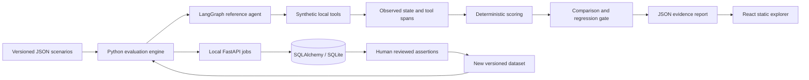

# Architecture

Domain contracts: `backend/src/agentguard/models.py`. Execution: `agent.py`. Assertions, aggregation and comparison: `engine.py`. HTTP contract: `connector.py`. Local persistence and jobs: `storage.py`, `api.py`. Public artifact generator: `scripts/generate_demo.py`.

An agent receives only input and context; the test runner holds expectations. Scores are calculated after execution. Multiple trajectories are allowed: required tools and argument subsets must occur, while explicitly forbidden tools must not occur. Extra nonforbidden calls are permitted.

Comparison requires matching dataset hashes, including assertions. Pass-rate threshold uses strict `drop > threshold`. Missing trace-dependent scores are null and excluded from evaluator denominators. Overall pass means no observed assertion failed; unavailable checks do not establish correctness. No statistical significance is inferred.

The local API stores runs separately, with one worker and at most two in-flight jobs. Process restart does not resume jobs. Reviewed tests require a failed source run, explicit approval and an editable scenario. Reviews and dataset snapshots persist in SQLite. Public Pages has no write path.
